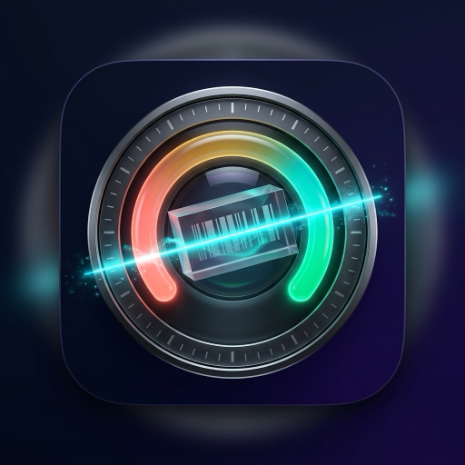

# Yarzar for iOS (iPhone & iPad)

**Food, Cosmetic & Whole-Food Health Scanner for iOS**

[macOS Repo](https://github.com/themanoftalent/Yarzar) · [Android Repo](https://github.com/themanoftalent/yarzar-android) · [Website](https://macosuygulama.vercel.app)

## Overview

Native SwiftUI iOS application (`iOS 17+`) for scanning food and cosmetic barcodes, reading ingredient labels with Apple Vision OCR, evaluating whole foods (GI & pesticide cleanliness), and discovering healthier alternatives.

## Author

Developed by **SoftAI Yazılım** · **Assoc. Prof. Dr. Mehmet Akif Cifci** ([@themanoftalent](https://github.com/themanoftalent))
